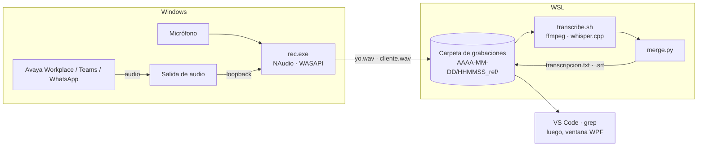

# Arquitectura

## Principio

Dos programas pequeños que no se conocen entre sí. **La carpeta de grabaciones es el contrato.**



## Componentes

| Componente | Responsabilidad | Tecnología | No hace |
|---|---|---|---|
| `rec/` | Capturar micrófono y audio del sistema en dos WAV | C#, .NET, NAudio (WASAPI) | Transcribir, mezclar, guardar metadatos |
| `transcribe/transcribe.sh` | Recorrer llamadas sin texto, convertir a 16 kHz mono y llamar a Whisper | bash, ffmpeg, whisper.cpp | Grabar |
| `transcribe/merge.py` | Unir las dos pistas en orden de tiempo con etiquetas Yo / Cliente | python3 (sin dependencias) | Transcribir |
| Ventana WPF (fase 3) | Grabar, listar, buscar y revisar con audio | WPF + WPF UI | Lógica de audio o de transcripción (usa los mismos procesos) |

## Decisiones (ADR breve)

1. **Dos pistas, no una mezcla.** Sabes quién habla sin modelo de diarización. Costo: dos transcripciones por llamada.
2. **Loopback + salida en silencio.** El loopback de WASAPI no entrega muestras si nada suena; una salida en silencio mantiene las pistas alineadas.
3. **Whisper en WSL con whisper.cpp.** Evita empaquetar modelos en el ejecutable de Windows y permite usar la GPU de WSL. Alternativa futura: Whisper.net dentro de la app.
4. **Sin base de datos.** La carpeta por día es la biblioteca; `grep` es la búsqueda. SQLite solo si la ventana lo necesita.
5. **Sin ajustes en pantalla.** Argumentos y variables de entorno hasta la fase 4.
6. **WPF y no WinUI 3.** Compila con el SDK de .NET desde la terminal, sin Visual Studio.
7. **Solo transcripción.** Resúmenes y análisis quedan fuera de alcance.

## Contrato de datos

```
<TRANSCRIPTOR_DIR>/AAAA-MM-DD/HHMMSS[_referencia]/
  yo.wav            micrófono del agente (formato nativo del dispositivo)
  cliente.wav       audio del sistema (formato nativo, normalmente float 32 bits)
  transcripcion.txt "[hh:mm:ss] Yo|Cliente: texto", una línea por segmento
  transcripcion.srt mismos segmentos con etiqueta
```

Una llamada está **pendiente** si no tiene `transcripcion.txt`; **transcrita** si lo tiene. Para reintentar, borra ese archivo.

## Flujo de una llamada

1. `rec` crea la carpeta, abre `yo.wav` y `cliente.wav` y empieza a escribir (con `Flush` en cada bloque).
2. Al pulsar Enter, cierra los archivos.
3. `transcribe.sh` convierte cada pista a 16 kHz mono, ejecuta whisper-cli (salida `.srt`) y llama a `merge.py`.
4. El agente abre `transcripcion.txt` o busca con `grep`.

## Fases

| Fase | Entrega | Listo cuando |
|---|---|---|
| 1 | `rec` (este repositorio) | Se escuchan las dos pistas por separado en Avaya Workplace, Teams y WhatsApp |
| 2 | `transcribe/` (este repositorio) | Una llamada produce `transcripcion.txt` comprensible |
| 3 | Ventana WPF compacta (`app/`) | Se graba, lista y revisa sin terminal |
| 4 | Ajustes, atajo global, bandeja | Se inicia con Windows y responde al atajo |

## Experiencia de desarrollo

- Código en el sistema de archivos de WSL (`~/transcriptor`), no en `/mnt/c`.
- `make build` compila; `make run` instala `rec.exe` en `%USERPROFILE%\Transcriptor` y lo lanza.
- Registros con `Console.WriteLine`; un WAV de prueba en `samples/`.
- Sin pruebas automatizadas, inyección de dependencias ni paquetes extra hasta que haga falta.

## Riesgos principales

- Capturar todo el audio de una salida puede mezclar fuentes: usar una salida dedicada o evaluar captura por proceso.
- Alguna aplicación puede usar audio exclusivo o protegido: probar cada canal en la fase 1.
- Sin GPU, `small` en CPU puede ser lento: transcribir por lotes.
